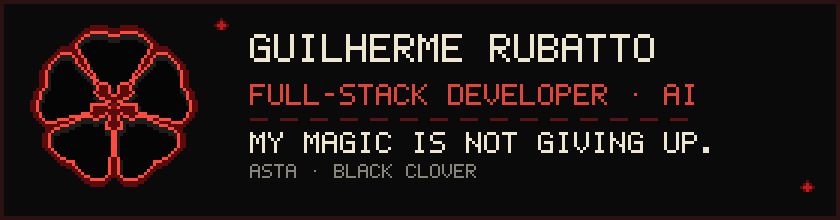

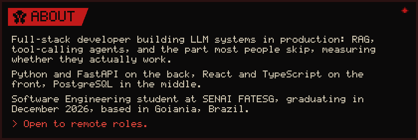

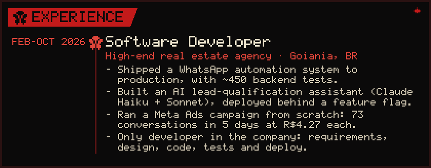

<a href="https://github.com/Rubatto-Dev/edital-radar">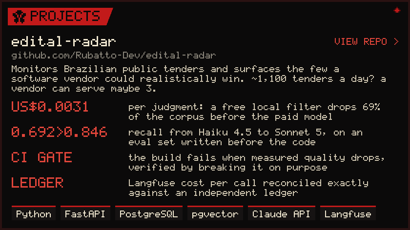</a>

<a href="https://github.com/Rubatto-Dev/nf-extractor">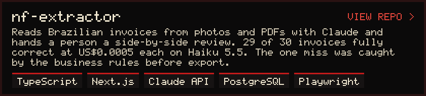</a>

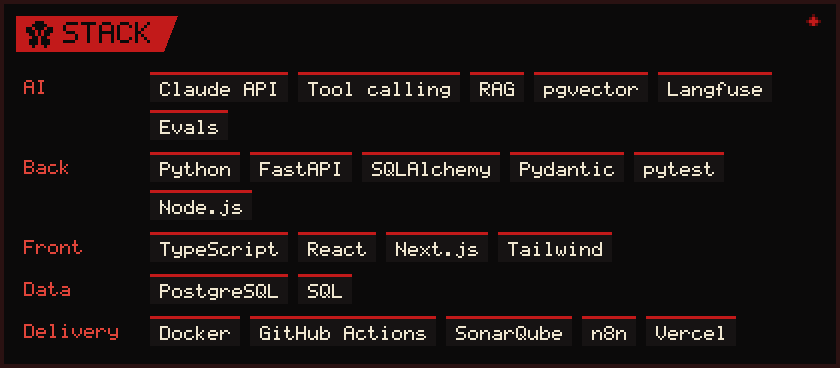

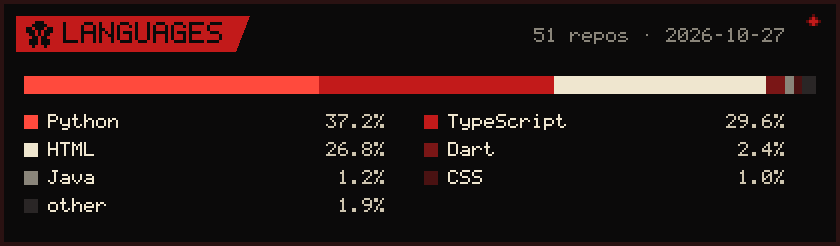

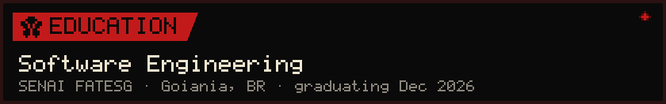

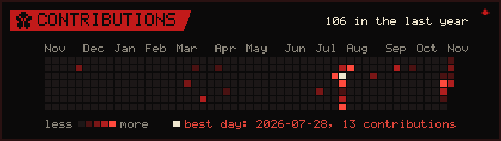

<a href="https://linkedin.com/in/guirubatto">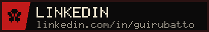</a>
<a href="mailto:rubattodev@gmail.com">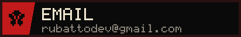</a>

